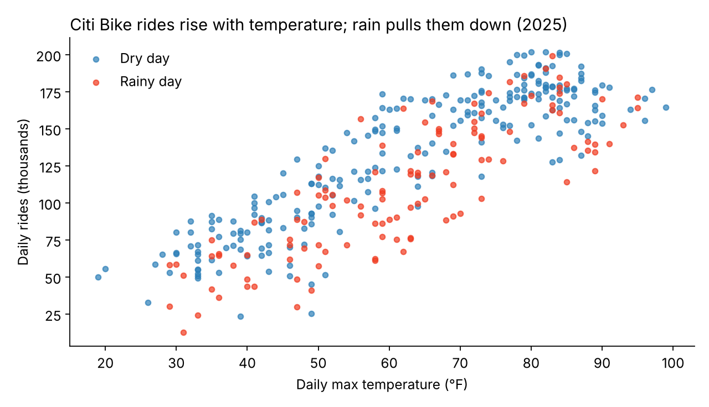
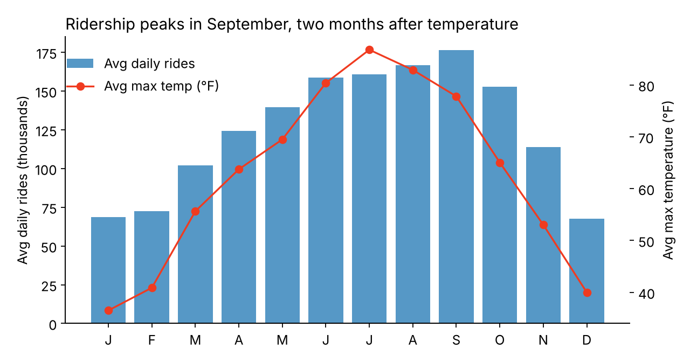

# Citi Bike Demand vs. Weather (NYC, 2025)

How much does weather drive bike-share demand? This project merges **45.8 million Citi Bike trips** (all of 2025, 53 monthly files) with **NOAA Central Park weather data**, aggregates them to daily demand, and models it.

**Weather plus calendar features explain 79% of day-to-day ridership** (5-fold cross-validated R²). A simple decision tree flags high-demand days with **88% out-of-sample accuracy**.

Columbia University APAN 5205 Machine Learning II, Spring 2026 (team project).



## Why it matters

Citi Bike rebalances bikes with vans, mostly reactively. If tomorrow's demand can be predicted from the weather forecast, operations can plan fleet moves and staffing ahead of time.

## Key findings

| Finding | Number |
| --- | --- |
| Temperature is the dominant driver | r = 0.84; **+2,031 rides** per extra °F of daily max temperature |
| Rain suppresses demand, especially for leisure riders | **−11.4%** on rainy weekdays vs. **−26.3%** on rainy weekends |
| Wind matters even on dry days | r = −0.52; **−1,181 rides** per extra mph |
| Each inch of rain | **−38,964 rides** (linear model) |
| Comfortable band | Demand falls off quickly below ~50 °F, and flattens or dips above ~80 °F |
| Seasonal lag | Temperature peaks in July, but ridership peaks in September |

**Takeaway:** weekday commuters are resilient to weather and weekend riders are not. Rain forecasts should change weekend rebalancing and promotions much more than weekday plans.



## Models (all scored out-of-sample)

| Features | Model | 5-fold CV R² |
| --- | --- | --- |
| Weather only (temp, rain, wind) | Linear Regression | 0.76 ± 0.04 |
| Weather only | Decision Tree (depth 5) | 0.71 ± 0.07 |
| **Weather + calendar** (weekend, month, weekday) | **Linear Regression** | **0.79 ± 0.03** |
| Weather + calendar | Decision Tree (depth 5) | 0.76 ± 0.07 |

**High- vs. low-demand classifier:** a decision tree (depth 3) labels each day above or below the median of 129,756 rides. It reaches **88.3% accuracy on held-out days** (5-fold stratified CV), with **94% recall** on high-demand days, so it rarely misses a busy day.

> **Why "out-of-sample" matters:** scoring a model on the same days it learned from flatters it. This tree scores 92% that way. Cross-validation instead hides one fifth of the days, trains on the rest, and tests on the hidden part, five times over. That gives the honest estimate of how it would do on future days.

## Data pipeline

1. **Citi Bike:** downloaded 53 monthly trip files for 2025 from the official Citi Bike S3 bucket, excluding Jersey City.
2. **NOAA:** pulled daily weather from several stations and chose Central Park (USW00094728), which had the most complete data.
3. **Merge:** joined every trip to its day's weather, building a 5.6 GB, 45.8M-row file.
4. **Aggregate:** used pandas chunked reading (100K–250K rows at a time) to fit in laptop memory, producing 360 daily records (`data/citibike_weather_daily_2025.csv`).

## Repository structure

```
├── data/citibike_weather_daily_2025.csv      # 360 daily rows (derived, public data)
├── src/model.py                              # reproduces every number and chart above
├── notebooks/
│   ├── 01_build_full_year_dataset.ipynb      # trip files + NOAA merge (chunked)
│   └── 02_analysis_and_models.ipynb          # original team analysis
└── images/
```

## How to run

```bash
pip install pandas scikit-learn matplotlib
python src/model.py      # prints all scores, saves charts to images/
```

The raw trip files come from [Citi Bike System Data](https://citibikenyc.com/system-data) and the weather data from [NOAA Climate Data Online](https://www.ncdc.noaa.gov/cdo-web/).

**Tools:** Python, pandas (chunked processing), scikit-learn (Linear Regression, Decision Trees, K-fold cross-validation), matplotlib
